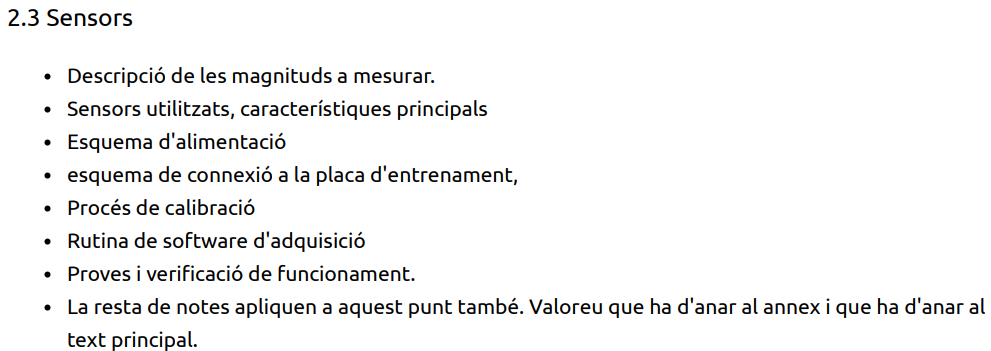
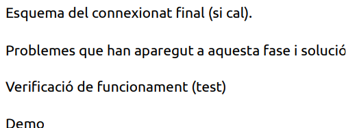

# **MEMORIA**

## **OBJETIVO**

 

El objetivo es diseñar y construir un dispositivo de monitorización ambiental para salas técnicas que alojen *racks* y servidores. El equipo medirá temperatura, humedad y CO₂, enviará los datos a *Sentilo* para su procesamiento y activará acciones preventivas (alertas, ventilación, corte de alimentación o señalización) para reducir el desgaste prematuro de componentes y detectar/actuar ante riesgos de incendio.

## **METODOLOGÍA**

Este proyecto se dividirá en tres fases.

La primera fase consta de tres tareas: el montaje del circuito, el desarrollo del firmware para el microprocesador y el desarrollo del software para Sentilo. Estas tres tareas podrán llevarse a cabo en paralelo, ya que son independientes entre sí.

La segunda fase consiste en integrar las diferentes partes desarrolladas durante la primera fase. En esta etapa se comprobará que el hardware, el firmware del microprocesador y el software de Sentilo funcionan correctamente de manera conjunta. En caso de detectar errores o incompatibilidades, se realizarán las correcciones o modificaciones necesarias para garantizar el correcto funcionamiento del sistema.

En la tercera fase se verificará el funcionamiento global del proyecto mediante pruebas simuladas, con el objetivo de comprobar que las respuestas del sistema se corresponden con las esperadas.

**Desglose de tareas de la fase 1:**

**Tarea A:** Selección del hardware que mejor se adapte a los requisitos y al enfoque del proyecto. Diseño y esquematización de las conexiones de los diferentes periféricos con el microprocesador. Finalmente, montaje físico de los componentes y conexión de estos al microprocesador.

- **INTRODUCIR EXPLICACION SOBRE PROCESADOR Y PERIFERICOS**

**Tarea B:** Desarrollo del firmware del microprocesador, incluyendo la instalación de las librerías necesarias para el funcionamiento de los periféricos y la compilación del código. Asimismo, se desarrollará e implementará la comunicación entre el microprocesador y el software *Sentilo*.

- **INTRODUCIR EXPLICACIÓN SOBRE FIRMWARE**

**Tarea C:** Desarrollo del software *Sentilo*, incluyendo la creación y configuración de los sensores y las alertas correspondientes. Definición de la estrategia de tratamiento de los datos recibidos, así como el desarrollo y la documentación de los cálculos necesarios para su correcto procesamiento.

- **INTRODUCIR EXPLICACION SOBRE SENTILO**

## **INTEGRACIÓN DE LAS TRES FASES**

Incluir lo siguiente:

## **CONCLUSIONES**

Incluir conclusiones y posibles mejoras

## **PRESUPUESTO DEL DESARROLLO**

Incluir costes del material usado para el prototipo

